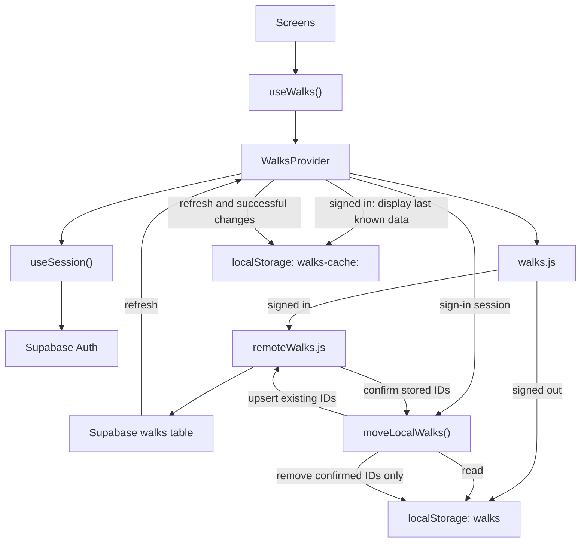

# Architecture and data flow

This guide explains how the app loads and saves walks so you can trace a screen action to its storage source. It is for contributors changing authentication, storage, migration, or caching.

## Big picture

Screens read and change walks through `useWalks()`. `WalksProvider` coordinates session state and walk data; `walks.js` selects browser storage when signed out and Supabase when signed in.

## Session and authentication

`useSession()` listens for Supabase auth state changes and reads the initial session. The Account screen sends email sign-in links and, in browsers with the WebAuthn API, offers passkey sign-in and management. Email remains an available sign-in method.

The browser client is configured in [`src/lib/supabase.js`](../src/lib/supabase.js). Session state lives in [`src/lib/useSession.js`](../src/lib/useSession.js), and the account flows live in [`src/pages/Account.jsx`](../src/pages/Account.jsx). See [ADR 003](decisions/003-magic-link-and-passkeys.md) for the sign-in choice.

## Walk access

Screens consume the shared context through `useWalks()`. The provider loads data for the current session, exposes save, edit, delete, import, and refresh operations, and keeps screens from choosing storage directly.

[`src/lib/WalksProvider.jsx`](../src/lib/WalksProvider.jsx) coordinates the context. [`src/lib/walks.js`](../src/lib/walks.js) chooses the signed-out or signed-in adapter. [`src/lib/storage.js`](../src/lib/storage.js) reads browser storage, while [`src/lib/remoteWalks.js`](../src/lib/remoteWalks.js) maps app fields to the Supabase table. The choice of storage by session is in [ADR 002](decisions/002-optional-sign-in-and-storage.md); the folder boundary is in [ADR 005](decisions/005-folders-by-code-responsibility.md).

## Signed-in cache and local-walk transfer

When signed in, the provider can display a per-user cache while it requests current walks from Supabase. A successful response replaces displayed data and refreshes the cache. Sign-out removes that user's cache. The cache is never used as a write source or uploaded.

After sign-in, [`src/lib/moveLocalWalks.js`](../src/lib/moveLocalWalks.js) uploads the signed-out `walks` records using their existing IDs, asks Supabase which IDs are present, and removes only those confirmed IDs from browser storage. The cache and transfer boundaries are recorded in [ADR 004](decisions/004-display-only-cache.md) and [ADR 002](decisions/002-optional-sign-in-and-storage.md).

## Related

- [Data model](data-model.md)
- [Supabase schema](../supabase/schema.sql)
- [Manual testing](testing.md)
- [Documentation index](README.md)
